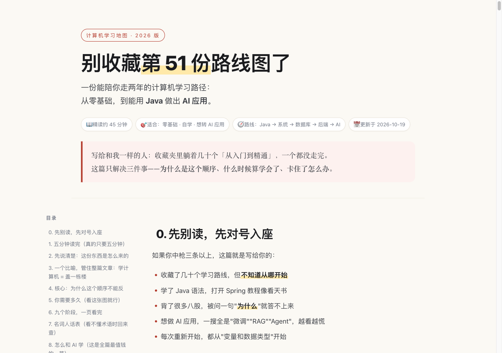
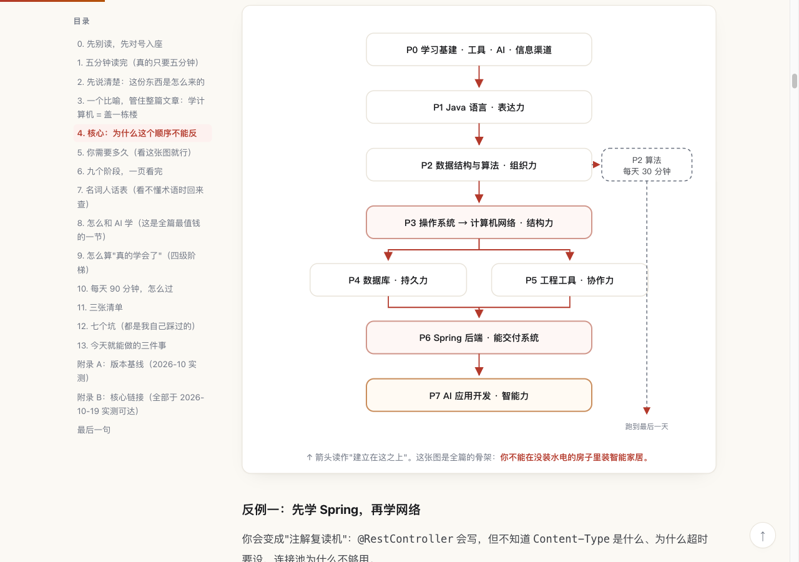
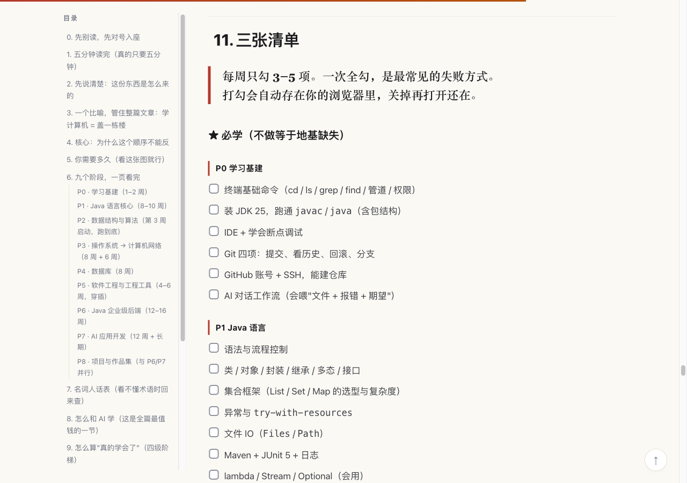
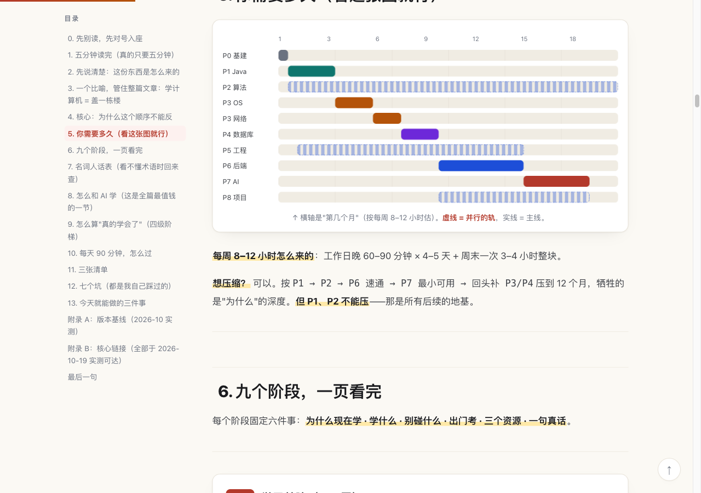
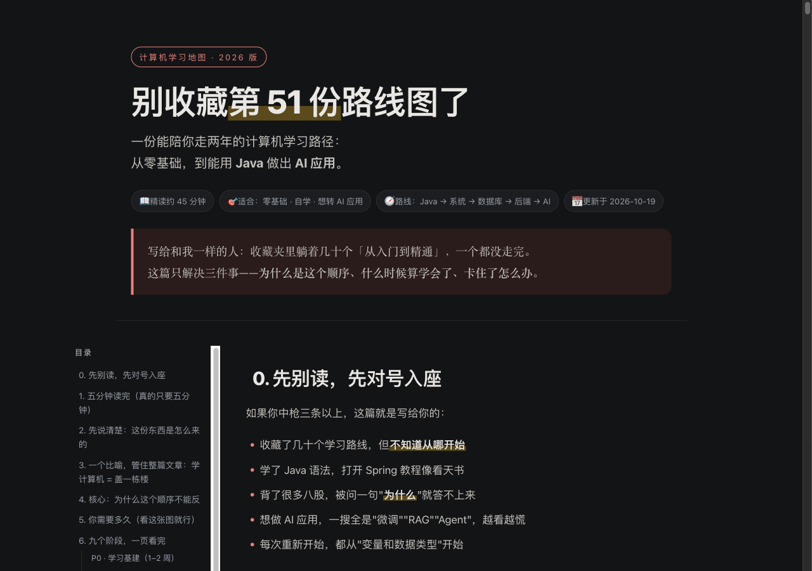

# 别收藏第 51 份路线图了

<sub>[English](README.en.md) · **简体中文**</sub>

> 一份能陪你走两年的计算机学习地图：从零基础，到能用 **Java** 做出 **AI 应用**。

[](LICENSE)
[](#参与改进)
[](https://chenguanji0711.github.io/java-to-ai-roadmap/)

**👉 在线阅读：[chenguanji0711.github.io/java-to-ai-roadmap](https://chenguanji0711.github.io/java-to-ai-roadmap/)**

---

## 这是写给谁的

如果你中枪三条以上，这个仓库就是写给你的：

- 收藏了几十个学习路线，但**不知道从哪开始**
- 学了 Java 语法，打开 Spring 教程像看天书
- 背了很多八股，被问一句"**为什么**"就答不上来
- 想做 AI 应用，一搜全是"微调""RAG""Agent"，越看越慌
- 每次重新开始，都从"变量和数据类型"开始

**不是你不够努力。** 是绝大多数路线图只告诉你"学什么"，从不告诉你三件更重要的事：

1. **为什么是这个顺序**（所以你不知道能不能跳）
2. **什么时候算学会了**（所以永远觉得没准备好）
3. **卡住了怎么办**（所以一卡就断，一断就重来）

这篇只解决这三件事。

---

## 它和别的路线图有什么不同

| 常见路线图 | 这份路线图 |
|---|---|
| 罗列知识点和网站 | 画出**依赖关系图**，解释每一层"为什么"藏在下层 |
| 只说要学，不说学到什么程度 | 每阶段有**出门考**：做不出来就不进下一阶段 |
| 按技术栈堆叠 | 按**能力链**排序：语言 → 数据结构 → 系统 → 数据 → 工程 → 后端 → AI |
| 假设你有大块时间 | 按**每周 8–12 小时**排时间轴，含断更恢复机制 |
| 术语直接甩脸上 | 附**名词人话表**（20 个术语一句话解释） |

一句话记住：**每一层的"为什么"，都藏在下面那一层。**

---

## 内容导览

| 章节 | 你会得到 |
|---|---|
| [0. 对号入座](https://chenguanji0711.github.io/java-to-ai-roadmap/#sec-1) | 确认这是不是写给你的 |
| [1. 五分钟读完](https://chenguanji0711.github.io/java-to-ai-roadmap/#sec-2) | 终点 / 路线 / 时间 / 验收，一屏看完 |
| [2. 这份东西的来历](https://chenguanji0711.github.io/java-to-ai-roadmap/#sec-3) | 参考了哪篇文章、我改了什么、**明确不采纳什么** |
| [3. 盖楼的比喻](https://chenguanji0711.github.io/java-to-ai-roadmap/#sec-4) | 九阶段对应盖楼九步，一次记住 |
| [4. 为什么顺序不能反](https://chenguanji0711.github.io/java-to-ai-roadmap/#sec-5) | 依赖关系图 + 三个"反了会怎样"的反例 |
| [5. 你需要多久](https://chenguanji0711.github.io/java-to-ai-roadmap/#sec-6) | 甘特图：主线与并行轨 |
| [6. 九个阶段](https://chenguanji0711.github.io/java-to-ai-roadmap/#sec-7) | P0–P8：为什么学 / 学什么 / 别碰什么 / 出门考 / 资源 |
| [7. 名词人话表](https://chenguanji0711.github.io/java-to-ai-roadmap/#sec-8) | JVM、B+ 树、RAG、embedding……一句人话 |
| [8. 怎么和 AI 学](https://chenguanji0711.github.io/java-to-ai-roadmap/#sec-9) | 8 个可直接复制的对话模板 + 防幻觉三条规则 |
| [9. 怎么算真学会](https://chenguanji0711.github.io/java-to-ai-roadmap/#sec-10) | 掌握四级（L1 记忆 → L4 改造）+ 三个自检动作 |
| [10. 每天 90 分钟](https://chenguanji0711.github.io/java-to-ai-roadmap/#sec-11) | 闭环图、5 行日志、周课/月课、断更恢复 |
| [11. 三张清单](https://chenguanji0711.github.io/java-to-ai-roadmap/#sec-12) | 必学 / 选学 / 不必学，**可打勾** |
| [12. 七个坑](https://chenguanji0711.github.io/java-to-ai-roadmap/#sec-13) | 每个坑的"自救"办法 |

---

## 看效果







<details>
<summary>更多截图（时间轴 / 暗色模式）</summary>





</details>

---

## 三种用法

| 你想要 | 打开 |
|---|---|
| **读**（推荐，有配色、图示、可交互） | [`index.html`](index.html) 或 [在线版](https://chenguanji0711.github.io/java-to-ai-roadmap/) |
| **改 / 复制片段 / 发公众号** | [`roadmap.md`](roadmap.md)（GitHub 会渲染彩色提示框、表格与复选框） |
| **打印 / 离线 / 丢进 iPad** | [`roadmap.pdf`](roadmap.pdf)（38 页） |
| **查细节（更密的参考手册）** | [`handbook.md`](handbook.md) |

> `index.html` 是**单文件、零外部依赖**的：CSS、JS、SVG 全部内联，断网也能看。
> 清单打勾会存在浏览器本地（localStorage），关掉再打开还在；**支持「导出 / 导入」JSON，换电脑、换浏览器都不丢进度**。

---

## 核心观点（可以先看这几句）

> **每一层的"为什么"，都藏在下面那一层。**

> **你可以不装智能家居，但不能没有水电。**（OS 与网络就是水电）

> **AI 应用 90% 是软件工程。** 所以 AI 放在最后，不是最前。

> **算法是唯一可以完全并行的模块**，第 3 周开始，跑到最后一天。

> 原文说"没人在意你做没做过项目，能圆回来就是你的"——**这条我不采纳**。长期做 AI 应用，面试官深挖两轮就露馅；更糟的是，这种心态会让你放弃真正动手。

---

## 版本基线（2026-10 实测）

| 组件 | 版本 | 注意 |
|---|---|---|
| JDK | **25（LTS）** | 最新 GA 是 27，但**非 LTS**；下一个 LTS 是 29（2027-09） |
| Spring Boot | **4.1.x** | 配 Spring Framework 7.x |
| Spring AI | **2.0.x** | 官方写明支持 Boot 4.0.x / 4.1.x |
| LangChain4j | **1.22.x** | 迭代快 |

> ⚠️ 版本错配是自学最大的隐形坑：大量中文教程还是 **Java 8 + Spring Boot 2.x**，Boot 3 起 `javax.*` 全迁到 `jakarta.*`。**以官方文档 + 官方 examples 为准，博客只看思路。**

---

## 来源与改动

主骨架来自飞书文档 **《后端学习路线》**（作者「花绿青」，写于 2026-07，最新修订 2026-07-27）：
<https://my.feishu.cn/wiki/DtjfwF73JibHfdkxkfsc9CWQnlg>

原文是**就业冲刺**视角（3–6 个月拿大厂后端 offer）。本仓库做了结构调整，并明确标注了三件事：

1. 终点从"通过面试"改为"**能独立做出并讲清一个系统**"；
2. 时间尺度从 3–6 个月拉长到 **20–26 个月**；
3. 原文末尾写着"未完待续：ai开发篇"——**AI 应用开发（P7）是我按其方法论补的，不是原文内容**，文中已标注。

---

## 参与改进

- 发现**失效链接**、**版本过时**、**知识点错误** → 欢迎开 Issue
- 有更好的资源推荐（尤其是中文一手资料）→ 欢迎 PR
- 想加自己的学习笔记 → Fork 后自由修改，署名即可

这个仓库会随版本变化更新（例如 JDK / Spring Boot 大版本升级）。

---

## License

[CC BY 4.0](LICENSE) © 2026 chenguanji0711

可自由复制、修改、分发（含商业用途），**保留署名**即可。
文中引用的第三方文章、文档、图片版权归原作者所有。

---

## 二次开发 / 自己改一份

`index.html` 是**生成**出来的，不要手改。改内容请改 `roadmap.md`，然后：

```bash
python3 tools/build_html.py     # roadmap.md  ->  index.html
```

- 脚本只依赖 Python 标准库，`mermaid` 代码块会被替换成项目自带的内联 SVG（保证单文件离线可用）
- PDF 用浏览器打印：打开 `index.html` → 文件 → 打印 → 存为 PDF（打印样式已适配，会隐藏目录与按钮）
- 想加新图：在 `tools/build_html.py` 的 `code_block()` 里加一条分支，同时保证 GitHub 上 Mermaid 也能渲染
- 清单区顶部的「导出 / 导入 / 重置」按钮就写在 `tools/build_html.py` 的 `TOOLBAR` 常量里

---

## 如果它帮到了你

- ⭐ **点个 Star** —— 能让更多正在迷路的人搜到它
- 🔗 **转给一个需要的朋友** —— 比收藏有用
- 🐛 **发现失效链接 / 版本过时** → 开 Issue，我会修
- 📅 清单会随版本更新（JDK、Spring Boot、Spring AI 大版本升级时）

> 一个人的学习路线，往往是被另一个人的路线图救活的。
