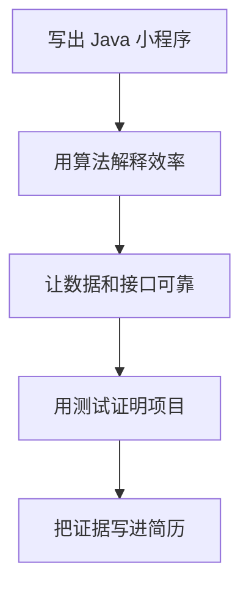
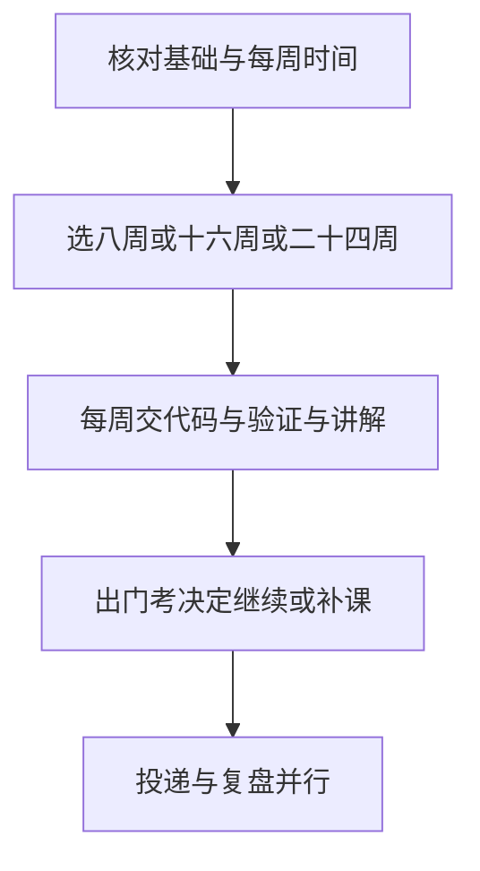
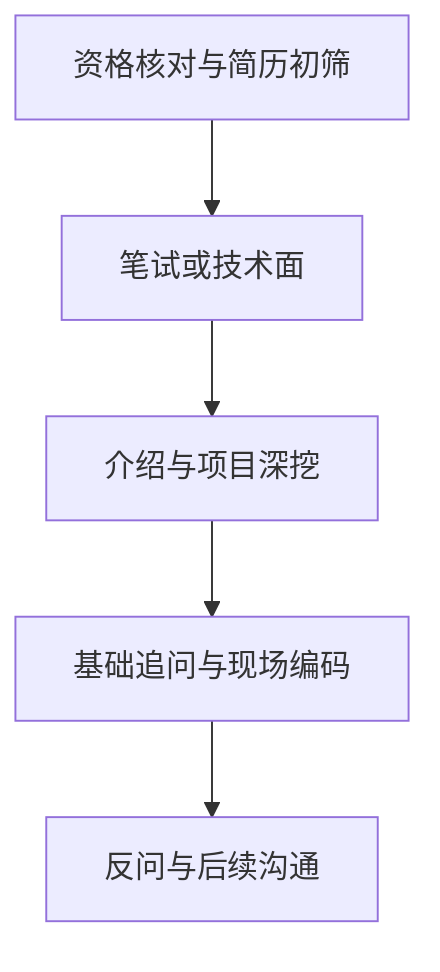

# 2026 实习冲刺版：把所学变成面试证据

### Java 后端为主线，AI 应用为加分项；8／16／24 周执行手册

## 1. 今天开始，用交付物换掉收藏夹

每天结束时，要有代码、测试或一次脱稿讲解留下来，别再只增加收藏。

“学会”是关教程能改需求，关 AI 能解释，弄坏还能定位。目标是争取初筛和技术面试机会，不承诺录用。

主线 16 周，零基础选 24 周，有 Java、SQL 和接口经验才选 8 周。阅读约 25–30 分钟，周表随用随查。

> [!WARNING]
> 周数是训练预算。每周只有 8 小时就拉长日历，别用看完视频冒充完成。先核对招聘窗口、学历和到岗要求，学习不能替代资格。

暂缓组成原理、CSAPP、MIT 6.1810、CS144；删去 JVM 调参、字节码和类加载全流程；不学一致性算法、DDD、微服务全家桶、K8s、消息队列集群。先交付可靠服务。

## 2. 面试官在寻找哪些证据

这节帮你把“我学过”改成“我能证明”，避免会背概念却接不住追问。

以下是本文评审判断，不是公司打分表；题目是训练问法，不是真实面经原题。

| 判断 | 面试里怎样留下证据 |
|---|---|
| 能否独立完成小需求 | 当场给接口加一个边界校验，解释失败时返回什么。 |
| 是否理解因果 | 讲缓存时说出数据库更新后为何可能读到旧值，再给取舍。 |
| 是否拥有项目 | 指出自己修过的一个 bug，展示复现条件和回归测试。 |
| 能否合作、承担责任 | 不会时说明已知边界和验证步骤，不把 AI 或队友当挡箭牌。 |

**模拟对话一：背过，不等于验证过。** 以下三幕均为教学模拟，不是真实面经或亲历记录。

候选人：“我重写了 `equals`，内容一样的键就能查到。”

面试官：“只重写它，不重写 `hashCode`，新建一个内容相同的键还能保证查到吗？”

候选人：“不能保证。我漏了相等键必须有相同散列值的约定。先写一个存入、取出的测试，再补齐两个方法。”

再追问：“存进去后改了参与散列的字段呢？”这次要画桶位置：查找可能去了另一个桶。两种错误要分别复现，不能把所有 `null` 都归因于没重写方法。

这也是本文的取舍标准：**凡是只能背、不能当场验证的，优先级都往后放。**



## 3. 选一条时间线，每周交三样东西

周末打开程序验收；跑不通，就知道下周该补哪里。

每周交代码、验证记录、录音。题量是新题预算，另复做错题，记录边界、复杂度与错误原因。卡住 20 分钟可看提示，隔天关答案重写。

没完成交付就顺延，先砍美化、多框架和 Agent 扩展。项目可复现、简历不虚构后，就小批投递，按反馈调整。



### 8 周版：已有基础，每周约 25–30 小时

这档帮你补证据缺口；写不出循环统计、SQL 查询和接口，就换较长档。

| 周 | 本周必须交付 |
|---|---|
| 1 | 写文件词频统计，补空文件测试；做 8 道数组／哈希题；录 3 分钟集合选型。 |
| 2 | 写有界线程池实验、复现计数竞争；做 8 道链表／栈题；解释一次拒绝任务。 |
| 3 | 给资料表造数据、比较索引前后计划，复现事务回滚；做 8 道二分题；讲扫描差异。 |
| 4 | 交付带登录、权限、分页的资料 API，复现并修复事务失效；做 8 道树题；画请求链路。 |
| 5 | 加缓存并测试过期、停机、重复提交；做 6 道堆／窗口题；录 5 分钟项目介绍。 |
| 6 | AI 方向做带引用的检索问答和 20 条评测；后端方向做等量接口故障用例；做 6 道搜索题。 |
| 7 | 从空环境复现项目，写一页简历，小批投递；做 6 道动态规划题；模拟面试一次。 |
| 8 | 按反馈修两项最大短板；限时重做 8 道错题；再模拟两次并更新投递记录。 |

### 16 周版：会基本语法，每周约 15–20 小时

这档帮你串联知识，第 7 周起迭代主项目。

| 周 | 本周必须交付 |
|---|---|
| 1 | 配好 JDK、Git、Maven；写命令行任务清单和 3 个测试；录一次断点定位。 |
| 2 | 加文件保存、接口和异常处理；做 5 道数组题；解释坏输入怎么处理。 |
| 3 | 用集合做词频统计，画 HashMap 冲突图；做 6 道哈希题；演示错误键设计。 |
| 4 | 写限额线程池实验，复现并修复计数竞争；做 6 道链表／栈题；讲锁与可见性。 |
| 5 | 写建表及 8 条查询，比较联合索引；做 5 道二分题；留存执行计划。 |
| 6 | 双连接观察隔离、回滚和锁等待；写缓存失效实验；做 5 道窗口题并讲一致性。 |
| 7 | 建资料管理 API，带参数校验、分页和错误码；做 5 道树题；画 HTTP 请求路径。 |
| 8 | 加登录与所有者权限，复现并修复自调用事务问题；做 5 道树题；交越权测试。 |
| 9 | 加缓存，覆盖穿透、击穿、雪崩的缩小实验；做 5 道堆题；说明降级边界。 |
| 10 | 加重复提交保护，压测固定读接口；做 5 道搜索题；保留吞吐与延迟原始记录。 |
| 11 | AI 方向做文档切分与检索基线；后端方向修一条慢查询；做 5 道回溯题并讲取舍。 |
| 12 | AI 方向加引用与拒答、完成 20 条评测；后端方向完成 20 条接口边界用例；做 5 道动态规划题。 |
| 13 | 复现超时、数据库断连或模型失败，补日志和回归；重做 6 道错题；写故障记录。 |
| 14 | 从空环境复现，录 5 分钟项目介绍；重做 6 道错题；写一页简历并开始投递。 |
| 15 | 做两次限时面试，修两项共性失分；重做 6 道错题；按 JD 调整简历证据顺序。 |
| 16 | 再做两次完整模拟，核对简历每句话；重做 6 道错题；依据回复继续投递。 |

### 24 周版：零基础起步，每周约 12–16 小时

先完成右栏，再补本周题目和讲解；最低标准不能替代阶段出门考。未完成就顺延，第 8 周仍写不出程序，就延长基础段。

| 周 | 本周必须交付 | 最小骨架与通过标准 |
|---|---|---|
| 1 | 安装 JDK 和编辑器，运行一个问候程序；改坏再修好；讲清源码如何运行。 | `Hello.java`：运行 `javac Hello.java && java Hello`，输出自己的名字。 |
| 2 | 写条件、循环和数组练习共 6 个；手算边界输入；用断点跟踪一次循环。 | `Sum.java`：循环求和；输入 0 得 0，输入 3 得 6，用断点核对。 |
| 3 | 写命令行记账器，拆成 3 个方法；加非法金额校验；录 2 分钟数据流。 | `Ledger.java`：用录入、求和、展示三个方法处理两笔账；负金额被拒绝。 |
| 4 | 把记录改成对象，为保存动作定义接口；替换一种实现；解释对象与接口。 | `Record` 保存金额，`Store` 约定保存动作；换实现后录入代码不变。 |
| 5 | 加列表、去重和分类统计；做 4 道数组题；解释 List、Set、Map 的选择。 | 录入餐饮 10、交通 5、餐饮 20；分类合计为 30、5，类别仅两种。 |
| 6 | 加文件保存和异常处理；写 4 个测试；演示坏文件不让程序直接崩掉。 | `ledger.txt`：保存后重启能读回；缺文件、坏金额、空文件、正常文件各测一次。 |
| 7 | 用 Git 分支修改统计规则并检查差异；做 4 道哈希题；写复现说明。 | `git diff` 能指出统计规则改了哪行；README 写清输入与预期结果。 |
| 8 | 关教程重写小工具核心，给陌生人按说明运行；复做 4 道错题；录 3 分钟讲解。 | 空目录重写录入和分类统计；另一人按 README 得到同样合计。 |
| 9 | 做词频统计和 HashMap 冲突实验；做 5 道链表题；画查找过程。 | 输入 `a b a` 输出 `a=2,b=1`；让两个不相等的键散列相同，验证均可取回。 |
| 10 | 做计数竞争与有界线程池实验；做 5 道栈题；录锁与 volatile 的差别。 | 两线程各加一万次，用锁后结果为两万；小队列加阻塞任务触发拒绝。 |
| 11 | 建资料表并写 8 条 SQL；做 5 道二分题；交索引前后执行计划。 | `schema.sql` 建表并造数；同一查询加索引前后各存一份 `EXPLAIN`。 |
| 12 | 用两个连接做回滚、隔离和锁等待实验；做 5 道窗口题；解释事务边界。 | 两终端连接同库：A 更新不提交，B 更新同一行等待；A 回滚后 B 继续。 |
| 13 | 写资料查询 API 和分页校验；做 5 道树题；记录请求、响应和状态码。 | `GET /api/resources?page=1` 返回列表；`page=0` 返回约定的参数错误。 |
| 14 | 加登录、所有者检查与事务；做 5 道树题；交越权和回滚测试。 | 甲建资料、乙读取应被拒绝；一次写入中途抛异常后，核对数据未落库。 |
| 15 | 加缓存并复现热点失效；做 5 道堆题；说明旧值与数据库压力的取舍。 | 给同一热门键设短过期；并发读取时记录回源次数，合并回源后再比。 |
| 16 | 加重复提交保护与超时处理；做 5 道搜索题；写一次失败请求的定位记录。 | 同一请求标识提交两次只新增一条；让依赖延迟超限，记录超时响应。 |
| 17 | 固定数据量压测一条接口并改一个瓶颈；做 5 道回溯题；保留前后原始数据。 | `bench.md` 固定数据量、并发和时长；改动前后各留延迟及错误率。 |
| 18 | AI 方向做检索基线；后端方向做故障恢复实验；做 5 道动态规划题并讲替代方案。 | AI：给三份短文做关键词检索并返回片段；后端：断开再恢复数据库，记录结果。 |
| 19 | AI 方向加引用、拒答；后端方向补接口边界；各交 20 条用例及失败分类。 | `cases.csv` 写满 20 条输入、预期、实际；AI 含无依据拒答，后端含越权请求。 |
| 20 | 修两类失败，保留一组未参与修改的验收题；重做 6 道错题；讲结果的局限。 | 另存未用于调试的验收用例；修复后同时跑旧用例与新用例，记录仍失败的项。 |
| 21 | 从空环境跑项目，补操作说明和演示；重做 6 道错题；录 5 分钟介绍。 | 新目录、空库按 README 启动；按占位符填入本地配置，即可演示新增和查询。 |
| 22 | 写一页简历，小批投递；模拟一次并修一个失分点；重做 6 道错题。 | `resume-v1` 每条贡献指向一份证据；投递表记录至少一条实际投递。 |
| 23 | 模拟两次，给项目连续追问 10 轮；重做 6 道错题；更新简历和投递记录。 | `mock.md` 记十轮追问；标出答不出的两问，补实验后重新录音。 |
| 24 | 对照 JD 补最大缺口，再模拟一次；重做 6 道错题；定下后续两周行动。 | 选一个实际岗位，把最大缺口写成任务；为后续两周各定一个交付物。 |

## 4. 六个阶段，过出门考再往下走

遇到追问，拿出实验和项目里的证据，别只报课程名。

### P0 · 写得出，也调得动

先写出能改的小程序，再碰框架。**为什么学**：否则需求一变，就只能重新找教程。

**学什么**

#### 1. 变量与对象

**变量**像贴标签的盒子。定义：保存值或引用的名字。面试答：“循环里每次更新总额。输入为零时不进循环，结果仍应为零。”

**对象**像带按钮的资料卡。定义：数据与行为的组合。面试答：“一条记录保存金额和分类。校验放在哪里，要看谁负责保证记录有效。”

#### 2. 接口

**接口**像插座规格。定义：调用方与实现方共同遵守的约定。面试答：“保存动作约定在接口里。文件保存换成数据库保存时，调用方仍按原约定调用。”

#### 3. 异常

**异常**像报警。定义：报告执行失败的机制。面试答：“坏金额在入口拒绝。文件读取失败要说明原因，不能假装读到了空账本。”

#### 4. 版本与构建

**Git** 像修改账本。定义：记录和比较文件版本的工具。面试答：“我用差异确认改了什么。提交只装同一个需求的改动，便于追查。”

**Maven** 像装配清单。定义：管理依赖与构建的工具。面试答：“依赖版本写入项目配置。别人按同一条命令构建，不靠我电脑上的手工设置。”

#### 5. 测试

**测试**像验收尺。定义：用输入和断言检查行为。面试答：“我先写清预期，再运行核对。正常输入通过后，还要测空文件和坏数据。”

**面试会怎么问**：① 给记录加一个字段，要改哪里？② 文件不存在怎么处理？③ 接口与实现拆开有什么收益？④ 如何定位这段空指针？

**答不上来会怎样**：现场修改卡住，项目代码难以自证。

**出门考**：不看教程写“文件读入→分类统计→输出”；覆盖空文件、坏数据、重复记录；断点定位一个故意制造的 bug，并讲 3 分钟。

**资源**：[dev.java](https://dev.java/learn/) 读语法、对象、异常。

---

### P1 · 集合、算法与并发的为什么

自定义键放进 Map 却取不出，不能只猜版本。**为什么学**：效率和线程安全会直接影响项目正确性。

**学什么**

#### 1. 集合选型

**集合**像收纳盒。定义：组织和操作一组元素的容器。面试答：“按顺序存用 List，去重用 Set，按键查用 Map。选型要看访问方式。”

#### 2. HashMap 与键

**HashMap** 像分区快递柜。定义：按散列定位桶的映射。面试答：“先定位桶，再比较键。冲突还要继续查找，扩容也有成本。”

**equals 与 hashCode** 像核对身份与分区编号。定义：前者判断相等，后者提供散列值。面试答：“相等的键必须有相同散列值，反过来不成立。重写时要配套，入表后也别改参与比较和散列的字段。”

#### 3. 复杂度

**复杂度**像估算人数翻倍后的排队量。定义：计算或存储量随输入规模增长的关系。面试答：“我先给朴素解，再减少重复工作。也要说明是否多用了空间。”

#### 4. 并发的三道追问

**线程**像同时办事的工人。定义：进程内的一条执行路径。面试答：“线程可共享数据。两个线程同时改总额，就可能互相覆盖。”

**锁**像门栓。定义：协调共享数据访问的同步机制。面试答：“相关读写使用同一把锁，临界区才能互斥。范围太大又会增加等待。”

**volatile** 像及时更新的公告栏。定义：提供可见性与特定有序性保证的修饰符。面试答：“它不能把读、加、写合成一步。所以 `count++` 仍可能丢计数。”

#### 5. 线程池

**线程池**像带候客区的窗口。定义：复用线程并管理待执行任务的机制。面试答：“先看核心线程，再看入队、扩到上限和拒绝。无界队列可能耗尽内存，容量要结合耗时与实测决定。”

**面试会怎么问**：① HashMap 冲突后怎么找？② 复合操作用了并发 Map 就安全吗？③ volatile 为什么防不住丢计数？④ 队列满了会怎样？⑤ 这题能少遍历一次吗？

**答不上来会怎样**：缓存键和并发请求讲不清；手撕换边界就出错。

**出门考**：画一次冲突与扩容；复现计数竞争并用锁修好；制造线程池拒绝；30 分钟独立写一道练过的中等题、解释复杂度并补边界测试。

**资源**：[线程池 API](https://docs.oracle.com/en/java/javase/25/docs/api/java.base/java/util/concurrent/ThreadPoolExecutor.html) 查排队；[Hello 算法](https://github.com/krahets/hello-algo) 按周表选题。

---

### P2 · MySQL 和 Redis：数据不能靠祈祷

查询慢，先拿执行计划说话。**为什么学**：能返回不代表查得快、写得对。

**学什么**

#### 1. 索引与查找

**索引**像书的目录。定义：加速定位数据的结构。面试答：“列顺序要配合查询条件。用 `EXPLAIN` 比较访问方式和估算扫描行数，再实测耗时。”

**B+ 树**像多层目录。定义：记录集中在叶层的平衡搜索树。面试答：“叶子相连，便于范围扫描。代价是额外空间和写入维护。”

#### 2. 覆盖与回表

**覆盖索引**像目录已写全答案。定义：查询所需列都可由索引提供。面试答：“只取索引中的列可减少额外访问。多查一列就可能改变计划。”

**回表**像按目录翻正文。定义：用二级索引中的主键查聚簇索引记录。面试答：“查非索引列可能要回表。比较覆盖与非覆盖查询时，要保持筛选条件一致。”

#### 3. 事务与可见性

**事务**像成套转账。定义：作为整体提交或回滚的操作单元。面试答：“扣款与入账放在同一事务。中途失败要验证两边都没落下半笔账。”

**隔离级别**像会议的旁听规则。定义：约束并发事务间可见性与相互影响的规则。面试答：“两个连接交错读写来验证。还要区分普通读和锁定读。”

**MVCC** 像文档历史版本。定义：用多个数据版本支持并发访问的机制。面试答：“快照按规则判断版本可见性。不能因此断言所有读都不加锁。”

#### 4. 缓存故障

**缓存**像桌边便签。定义：为快速访问保存的数据副本。面试答：“先说明允许多旧。写库后删缓存仍有竞争，关键状态回数据库核实。”

**穿透**像反复找不存在的书。定义：不存在的数据查询持续回源。面试答：“可短期缓存空值。还要限制滥用请求。”

**击穿**像热门窗口突然关门。定义：热点缓存失效引发集中回源。面试答：“可合并并发回源。等待也要有超时。”

**雪崩**像多处窗口同时关门。定义：大批缓存失效或服务故障导致集中回源。面试答：“过期时间错开，故障时限流降级。全量回源可能压垮数据库。”

**面试会怎么问**：① 联合索引为什么这样排列？② 执行计划怎么看？③ 转账中途失败会怎样？④ 缓存三种故障有什么不同？⑤ 数据更新后仍读到旧值怎么办？

**答不上来会怎样**：优化无依据，重复写入和脏数据兜不住。

**出门考**：造足以比较差异的数据，保留索引前后计划；双连接复现回滚与锁等待；模拟热点失效和 Redis 不可用，验证接口有超时与降级。

**资源**：[MySQL 索引手册](https://dev.mysql.com/doc/refman/8.4/en/optimization-indexes.html) 对照自己的 SQL；[Redis 键与过期](https://redis.io/docs/latest/develop/use/keyspace/) 用来做失效实验。

---

### P3 · HTTP、Spring 与排错

从接口一路讲到数据库，这节让你接住调用链追问。

**为什么学**：否则只会背注解，遇到权限、事务或超时问题就无从定位。

**学什么**

**HTTP** 像业务信件，是应用层的请求/响应协议；**TCP** 像带编号和确认的运输通道，保证可靠有序的字节流。握手负责建连和确认初始序号，挥手关闭两个方向——报文可能合并，这也是为什么抓包时看到的时序和你以为的不一样。

**字节流没有消息边界**，得靠长度或分隔符切分。HTTP 本身无状态，登录靠 Cookie 带会话标识；HTTPS 在中间加一层 TLS 保护传输。

**认证和授权**要分清楚：认证是“你是谁”，授权是“你能看谁的资料”。顺带答一句“超时重试为什么可能重复写”——很多人只会说“要幂等”，说不出为什么。

**IoC** 像食堂统一配餐：容器创建、管理对象并注入依赖。**AOP** 像门口统一查票：在业务调用周围织入通用逻辑。回答时画一条 `Controller → Service → 数据库`，把校验、事务、异常处理标在正确的位置上。

**事务代理**像必须经过的验票口。默认代理模式下：同类内部自调用会**绕过代理**；吞掉异常可能让代理无法按预期回滚；默认回滚规则也不覆盖所有受检异常。结论：**“加了注解” ≠ “事务生效”**。

**JVM** 像车间：堆里放对象，栈里存调用帧，GC 回收不可达对象。练的是排查路径——CPU 高查忙线程，内存涨查对象保留，响应慢查依赖。**先留证据，再改参数。**

**面试会怎么问**：① 请求超时能直接重试吗？② TCP 为什么要确认序号？③ IoC 与自己 new 有何区别？④ 自调用事务为何没生效？⑤ CPU 高时先看什么？

**答不上来会怎样**：能背注解却不能定位异常；权限或事务漏洞会削弱整个项目的可信度。

**出门考**：交付校验、分页、登录和所有者检查；证明用户甲不能读乙的资料；写事务回滚集成测试；用线程转储定位一个自造忙循环。

**资源**：[MDN HTTP](https://developer.mozilla.org/zh-CN/docs/Web/HTTP) 看报文；[事务注解说明](https://docs.spring.io/spring-framework/reference/data-access/transaction/declarative/annotations.html) 核对代理与回滚。

---

### P4 · AI 应用：先检索，再证明有效

这阶段帮你避免把“接过模型接口”写成 AI 工程能力。**为什么学**：投 AI 应用岗要证明质量、失败处理和成本控制。

**学什么**

**RAG** 像开卷考试：先检索资料，再让模型照着答。面试要能区分两种失败——**“找错了资料”**和**“资料对了但答错”**，因为改法完全不同。

**Embedding** 像给文本画语义坐标，把内容变成向量。记住一句：**向量相近不等于事实正确**。

**Prompt 工程**像写任务委托书：讲清输入、约束、示例、输出格式，然后用同一批题迭代。面试时展示“我改了什么、同一批题的结果怎么变”，而不是背万能咒语。

**Agent** 像会自己决定下一步的助手：模型参与决定调什么工具、走哪条路。但**固定流程通常更容易测**——所以要能回答“为什么这里真的需要自主选择”，以及步数上限、超时和失败出口在哪。

**MCP** 像统一插口，是连接 AI 应用与工具、资源的协议。它**不自动给权限**，也不是 Agent 的别名。面试要说明：工具参数校验、访问控制、敏感操作二次确认，分别在哪一层做。

**评测**像固定试卷，用同一把尺子比较系统。标 20 条：正常 / 无答案 / 歧义 / 越权 / 诱导指令，各 4 条；记录资料命中、引用支持、是否拒答、耗时。**另外留一批没见过的题做验收**——只优化见过的题，等于背答案。

**面试会怎么问**：① 没检索到和模型胡答怎么区分？② 分块变大有什么代价？③ 引用存在就算答对吗？④ 为什么不用固定流程？⑤ 恶意文档让工具导出数据怎么办？

**答不上来会怎样**：项目像接口包装；“准确率高”没有口径就不构成证据。

**出门考**：同一份非敏感资料跑关键词检索基线与一次改进；保留逐题结果及失败原因；展示无依据拒答和越权阻断。没实调模型时标“模拟响应验证”，不能把它当效果评测。

**资源**：[Spring AI](https://docs.spring.io/spring-ai/reference/getting-started.html) 学接入；[MCP](https://modelcontextprotocol.io/docs/2026-07-28/learn/architecture) 区分各角色。框架只学一个。

---

### P5 · 项目交付与面试表达

把自己的贡献摆出来，让对方能找到证据。

**为什么学**：只有代码仓库，没有复现和讲解，贡献很难核实。

**学什么**：复现说明像菜谱，让别人得到同一结果；回归测试像修桥后复检，检查修复是否破坏原行为。回答要串起需求、实现、测试与证据。

**面试会怎么问**：① 哪部分由你负责？② 为什么没选另一种方案？③ 指标如何测？④ 今天需求变了你改哪？⑤ 让别人运行需要几步？

**答不上来会怎样**：技术栈越多，无法自证的漏洞越多。

**出门考**：从空环境按说明运行；5 分钟脱稿介绍；接受第 5 节十轮追问；简历每条都能定位到代码、测试或记录。

**资源**：用 [Git Book](https://git-scm.com/book/zh/v2) 整理可读的修改历史。

---

## 5. 一个项目，讲五分钟，追十轮

**项目不是讲出来的，是「跑得起来 + 说得清」证明出来的。**

做“带权限的资料库”：保存、分类、检索资料。后端方向做可靠查询与缓存，AI 方向在同一服务上加带引用问答。

幂等像快递单号，重扫不应重复发货；定义是重复请求不额外改变结果。回答用户范围内的请求标识、唯一约束、重复响应和过期规则，别只放个内存标记。

| 迭代 | 完成标准 |
|---|---|
| 能用 | 资料新增、分页、分类可演示；非法输入有稳定错误响应。 |
| 可靠 | 登录、所有者检查、事务和重复提交都有失败测试；日志能关联一次请求。 |
| 可交接 | 有启动步骤、配置占位符、测试命令、限制说明和短演示；没有密钥与个人资料。 |

P95 像排序后靠后的等待时间，是 95% 请求不超过的延迟分位数。报告写机器、数据量、并发、预热、时长和错误率；本机实验别写“生产级”。

五分钟练习预算：半分钟讲痛点，一分钟画路径，一分半讲难点，一分钟讲测试与指标，一分钟讲局限和下一步。

十轮追问按因果走：① 谁使用？② 数据怎么存？③ 为什么选这张表？④ 为什么这个索引？⑤ 缓存旧了呢？⑥ 两次提交呢？⑦ 他人越权呢？⑧ 依赖超时呢？⑨ 测试怎么证明？⑩ 不用当前方案还有什么选择？

**模拟对话二：讲了三分钟，仍没讲到自己做的事。**

候选人：“项目用了微服务、缓存，还准备加智能问答……”

面试官打断：“先停一下。分页变慢时，你具体查了什么？”

候选人：“先从日志确认慢在数据库调用，再看执行计划。我调整索引后，用同一批数据复测；前后记录都保留了。”

练习时把技术名词换成这条线：哪个请求出了问题 → 怎么定位 → 改了什么 → 怎样证明。没有真实做过的实验，就先做，不能借模拟对话冒充经历。

反例：“高并发智能中台，性能提升 90%。”却说不出负载与原始数据。改写为“比较资料分页索引前后执行计划，保留复现步骤”，实测后再填结果。

## 6. 一页简历与 JD：关键词必须带证据

这节帮你减少初筛信息缺失，不能绕过资格要求。

初筛像配零件，判断经历是否符合岗位。学历、专业、毕业时间、实习时长、到岗时间可能是硬条件；关键词帮助检索和阅读，不同团队权重不同，没有保证通过的公式。

一页按“联系与方向→教育与到岗→经历／项目→技能证据”排。有相关实习优先展示，无实习就突出项目；成绩、排名只写真实相关的，不伪造学历与工作量。

```text
姓名｜求职：Java 后端实习｜联系方式
学校／专业／毕业时间｜可到岗日期／每周天数／连续月数
项目：服务谁、解决什么问题（两行以内）
贡献：问题 → 我的动作 → 测试或实测结果 → 证据入口
技能：能用 HashMap 分析查找，能用 EXPLAIN 验证索引等
仓库或演示：可访问入口；保留运行说明，不含密钥
```

反例：“熟悉 Java、MySQL、Redis”。改为“实现用户隔离接口，验证越权、回滚和重复提交”。个人项目别写成企业任职。

JD 像采购清单，是岗位职责与条件说明。本文无全市场统计，不把某词一概当凑数；看实际交付要求，再看“了解／优先”。

| 关键词 | 怎样判断是否要重点准备 |
|---|---|
| RAG | 要做知识库就准备切分、召回、引用与失败分析；只列词时问清任务。 |
| Agent | 要做多步任务就准备状态、失败恢复和上限；解释固定流程是否够用。 |
| MCP | 要接工具就准备协议角色、权限与参数校验，不堆服务。 |
| 评测 | 要改善效果就拿出逐题结果、标注标准与对照。 |
| Prompt 工程 | 要稳定输出就准备格式验证、失败样例与回归，不比谁提示长。 |

投递记录不是给 HR 看的，是**给你自己复盘用的**。没有记录，你的复盘就只是在猜。

| 日期 | 公司/岗位 | 简历版本 | 结果 | 下一步 |
|---|---|---|---|---|
| 例：10-20 | A 厂 · Java 后端实习 | v2（突出索引优化） | 简历挂 | 核对 JD 是否要求学历/到岗 |
| 例：10-23 | B 厂 · AI 应用实习 | v3（突出评测） | 一面挂 · 问倒 RAG | 补「检索失败 vs 生成失败」 |

投递表记岗位、资格、关键词、简历版本、日期与反馈。没回复先查匹配度；技术面反复失败再分类补课。

## 7. 面试流程：把时间花在能验证的地方

按一小时练一次模拟面试，检查项目、基础和编码哪一段最容易卡住。



实际轮数与顺序因岗位而异，八股与手撕无统一比例。60 分钟模拟可分：介绍 3 分钟、项目 20 分钟、基础 12 分钟、编码 20 分钟、反问 5 分钟。这是练习建议，不是统计。

介绍讲身份、可实习多久、做过什么、值得追问哪个点。例：“我的资料库处理了重复提交与缓存失效，有失败用例，可以展开。”没做过就别照念。

八股讲类比、定义和实验；手撕确认输入输出和边界，给朴素解与优化，再编码测试。不确定就提出反例验证，别编结论。

反问：“实习生前四周交付什么？”“谁负责评审和测试？”“更看重检索效果还是后端可靠性？”让回答帮助你选岗位。

## 8. AI 协作：用过工具，也要拥有代码

这节帮你保住可信度：AI 生成的代码也要能解释。

Vibe coding 像让助手按口述搭积木，用自然语言推动代码生成。原型可以快；进项目要 review、测试、验证依赖。这是分工建议，不是团队制度统计。

面试会检查理解与验证。提交的每一行都应能解释目的、输入输出、失败条件与替代方案；不要求背第三方库源码。

据我观察，面试追问 AI 代码时，重点是你能否解释取舍、定位故障。说不清为什么这样写，就缺少独立维护它的证据。

**模拟对话三：AI 写完了，责任还在你。**

面试官：“这段重复提交保护是你写的吗？用内存里的标记，多开一个服务实例还挡得住吗？”

候选人：“初稿由 AI 生成。我只测了单实例，两个实例不共享标记，这里没验证够。”

面试官：“你准备怎么补？”

候选人：“先用同一请求标识并发请求两个实例，复现重复写入。再用用户范围内的请求标识加数据库唯一约束，补重复响应与失败重试测试。”

用 AI 后必须自己做三件事：解释改动及取舍；执行失败测试并核对结果；关掉 AI 独立改一次边界需求。三件事没做齐，就别把生成当完成。

你定验收→AI 给小步方案→你看 diff→跑测试→独立改需求。Review 像交稿前审阅，核对变化与需求；测试只覆盖设计过的情况，不失败不等于无缺陷。

```text
需求：给我的资料接口增加重复提交保护。
先指出现有调用路径与不确定之处，不要直接大改。
给两个方案，说明并发、过期和失败重试的差异。
我选定方案后，只改必要部分，并列出可复现的失败测试。
不要读取或输出密钥，不要添加未核实的依赖。
完成后逐段解释；由我独立修改一个边界场景再验收。
```

问清获准工具、数据能否外发、谁 review、必过测试。内部代码、用户资料与凭据按团队规则处理，提交者仍对缺陷负责。面试用 AI 先获允许。

被问穿时：“初稿由 AI 生成，我验证了这些路径；这里理解不够，我给一个可解释的简化方案。”面后删掉无法自证的表述，补测试、独立重写核心。

## 9. 80／20 清单：投递前的最低证据

**投递前用这张表查一遍短板——它不保证通过，但能告诉你输在哪。**

验证后才打勾。进度保存在本浏览器，与长线版分开；投递前重新抽测。

**P0 独立编码**

- [ ] 关教程完成文件统计，能处理坏输入并断点定位。
- [ ] 能用 Git 解释一次差异，别人按说明可运行程序。

**P1 基础推理**

- [ ] 画 HashMap 查找与冲突，解释集合选型和可变键风险。
- [ ] 复现计数竞争与任务拒绝，说明锁、volatile 和队列边界。
- [ ] 限时完成数组、链表、树的代表题，并解释复杂度和边界。

**P2 数据可靠**

- [ ] 用执行计划证明一次索引选择，双连接验证事务边界。
- [ ] 演示缓存三类故障的区别，说明一致性与降级限制。

**P3 接口可靠**

- [ ] 讲清 HTTP／TCP 与请求路径，验证事务失效的修复。
- [ ] 越权、重复提交、超时都有失败测试和可定位日志。

**P4 岗位加分**

- [ ] AI 方向交引用、拒答与逐题评测；后端方向交故障实验与回归结果。

**P5 面试证据**

- [ ] 项目能讲 5 分钟并接十轮追问，指标有原始记录。
- [ ] 简历一页且每条可自证，完成至少两次模拟并修复共性问题。

## 10. 常见死法：失败要能定位

这节帮你止损：把拒绝变成能修的缺口。

| 失败表现 | 下次行动 |
|---|---|
| 学了一堆却没有能运行的项目 | 暂停新课，先交一条从请求到数据库的完整路径。 |
| 项目讲架构，追问只说“框架帮我做了” | 选一条请求画调用路径，逐层做一次失败实验。 |
| 刷题只记答案，换输入就错 | 先手推边界，再关答案重写；记录识别特征和反例。 |
| 简历写满 AI 名词，没有效果证据 | 删除未做内容，补同一题集上的对照与失败样例。 |
| 不会却硬猜，越答越矛盾 | 明确已知与未知，提出最小验证步骤。 |

## 11. 版本与来源：让材料可核对

这节帮你避免版本混用；运行依赖以实际项目为准。

2026-10-19 核验：JDK 25 LTS、Spring Boot 4.1.x、Spring AI 2.0.x、LangChain4j 1.22.x。LTS 是长期支持标记，具体条款看发行版。

依据为 [Oracle 支持路线](https://www.oracle.com/java/technologies/java-se-support-roadmap.html)、[Boot 4.1.1 发布](https://github.com/spring-projects/spring-boot/releases/tag/v4.1.1)、[Spring AI 2.0.1 发布](https://github.com/spring-projects/spring-ai/releases/tag/v2.0.1)、[LangChain4j 1.22.0 发布](https://github.com/langchain4j/langchain4j/releases/tag/1.22.0)。Spring AI 官方入门说明支持 Boot 4.0.x／4.1.x；LangChain4j 部分模块带 beta 后缀，按模块文档选，别统一替换数字。

本文未实跑这些 Java 组合。建项目时锁定补丁版本、跑最小测试。外链沿用副编首轮核查结果：无非预期坏链，MySQL 文档对脚本返回 403；本轮未新增外链，未重复实测。

**关于这份文档**：主骨架来自飞书《后端学习路线》（花绿青），由本仓库长线版再编。AI 应用开发及求职训练为方法论外推，不是面试题库或录用保证。沿用 CC BY 4.0。
