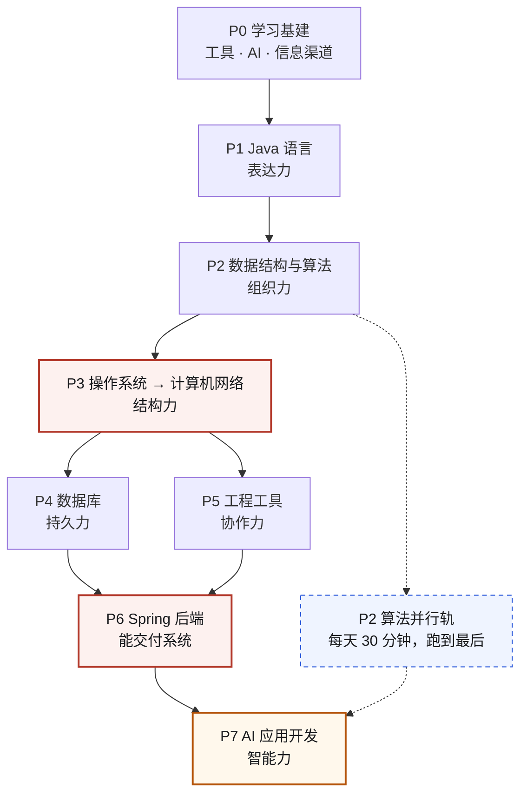
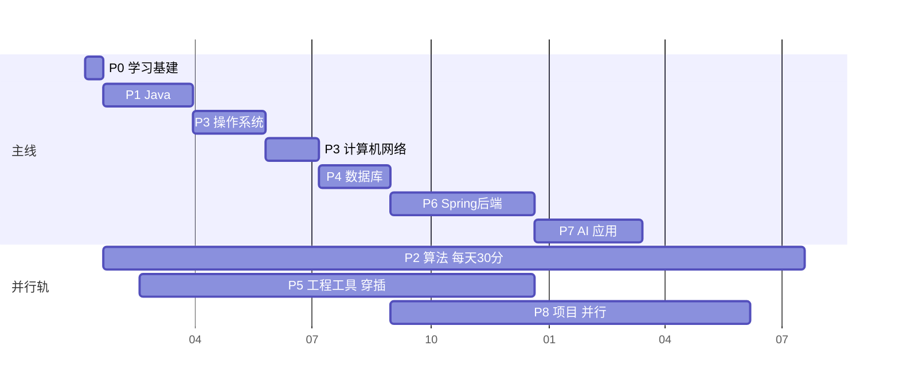
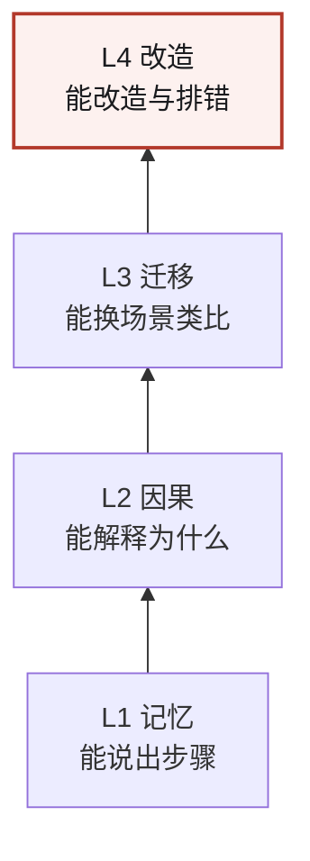
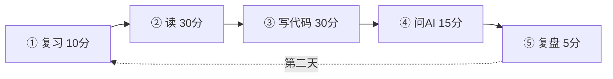

# 别收藏第 51 份路线图了

### 一份能陪你走两年的计算机学习地图：从零基础，到能用 Java 做 AI 应用

> 写给和我一样的人：收藏夹里躺着几十个"从入门到精通"，一个都没走完。

---

## 0. 先别读，先对号入座

如果你中枪三条以上，这篇就是写给你的：

- 收藏了几十个学习路线，但**不知道从哪开始**
- 学了 Java 语法，打开 Spring 教程像看天书
- 背了很多八股，被问一句"**为什么**"就答不上来
- 想做 AI 应用，一搜全是"微调""RAG""Agent"，越看越慌
- 每次重新开始，都从"变量和数据类型"开始

**不是你不够努力。** 是绝大多数路线图只告诉你"学什么"，从不告诉你三件更重要的事：

1. **为什么是这个顺序**（所以你不知道能不能跳）
2. **什么时候算学会了**（所以永远觉得没准备好）
3. **卡住了怎么办**（所以一卡就断，一断就重来）

这篇只解决这三件事。顺带把顺序、标准、资源、练法都落到能执行的程度。

---

## 1. 五分钟读完（真的只要五分钟）

| | |
|---|---|
| 🎯 **终点** | 能独立做出一个系统，并且能讲清每个设计决策的取舍（**不是**"学完计算机"） |
| 🧭 **路线** | 语言 → 数据结构 → 操作系统 → 网络 → 数据库 → 工程 → Spring 后端 → AI 应用 |
| ⏱️ **时间** | 每周 8–12 小时，约 20–26 个月到"能独立交付 AI 应用" |
| 🧪 **验收** | 每阶段都有"出门考"：做不出来，就不进下一阶段 |
| ⚔️ **唯一必须并行的** | 算法。第 3 周开始，跑到最后一天 |
| ☠️ **最常见的死法** | 跳过基础直接学框架——99% 的人死在这 |

> [!TIP]
> **三种读法**：① 只有 20 分钟 → 读第 1、2、4 节（终点 / 路线 / 为什么不能跳）；② 想马上动起来 → 直接跳到第 13 节「今天就能做的三件事」；③ 当手册用 → 从目录按阶段查，看不懂的名词去第 7 节。

> **一句话记住：每一层的"为什么"，都藏在下面那一层。**

---

## 2. 先说清楚：这份东西是怎么来的

它不是我凭空编的，主骨架来自一篇飞书文档——**《后端学习路线》**（作者「花绿青」，2026 年 7 月写于北京）。

作者是个 9 本本科生，Java 主语言，写的时候在 TikTok 实习，同期拿了一堆 offer。所以他那份文档的视角是：**3–6 个月冲刺大厂后端**。

我把它拆了，重新装了一遍。三件事必须坦白：

**① 他的终点是"过面试"，我换成了"能独立做出并讲清一个系统"。**
理由很现实：只盯着面试，最后一定滑向背八股；而"能讲清取舍"这个标准，天然包含面试能力，而且不会过期。

**② 他的时间尺度是 3–6 个月，我拉长到 20 个月以上。**
冲刺和长期是两种运动。冲刺靠爆发，长期靠不受伤。

**③ 他文档末尾写着"未完待续：ai开发篇"——AI 那篇当时没发。**
所以第 7 阶段（AI 应用开发）是我按他的方法论补的，**不是原文内容**。我在文里标了。

我还**明确不采纳**他一句话：

> ❌ "没人在意你究竟做没做这个项目，只要能圆回来就都是你的。"

这是冲刺期的风险策略。你要长期做 AI 应用，面试官深挖两轮就露馅；更糟的是，这种心态会让你放弃真正动手——那恰好摧毁你的目标。

---

## 3. 一个比喻，管住整篇文章：学计算机 = 盖一栋楼

后面你会看到很多"为什么不能跳"，用这个比喻看就通了：

| 阶段 | 盖楼时你在干什么 | 一句话人话 |
|---|---|---|
| P0 学习基建 | 平场地、拉电线、请施工队 | 工具没搭好，后面每一步都在还债 |
| P1 Java 语言 | 搬砖、和水泥 | 没有砖，谈什么设计 |
| P2 数据结构与算法 | 结构力学 | 决定楼能盖多高，且**决定后面所有楼层怎么受力** |
| P3 操作系统 + 网络 | 水电管线 | **装完就看不见了**，但决定这楼能不能住人 |
| P4 数据库 | 仓库与档案室 | 东西存哪、怎么一秒找到 |
| P5 工程工具 | 施工规范与监理 | 让第二个人能接手你的工地 |
| P6 Spring 后端 | 装修交付 | 能住人了，可以开门迎客 |
| P7 AI 应用 | 装智能家居 | 在能住的房子里加"会思考"的能力 |
| P8 项目 | 样板间 | 让别人一眼看到你的水平 |

一句话：**你可以不装智能家居，但不能没有水电。**

---

## 4. 核心：为什么这个顺序不能反



### 反例一：先学 Spring，再学网络

你会变成"注解复读机"：`@RestController` 会写，但不知道 `Content-Type` 是什么、为什么超时要设、连接池为什么不够用。

**网络是 Spring 的地基。** 你写的每个接口，本质是"一个 HTTP 请求进来 → 一个线程处理 → 一个响应出去"。

### 反例二：先学 JUC（并发），再学操作系统

你会开始背八股："线程池有七个参数……"。但你说不出：为什么核心线程数要这么定？为什么 `volatile` 不能保证原子性？

因为**这些答案全在操作系统里**：线程模型、调度、内存可见性。跳过 OS 学 JUC，等于背结论。

### 反例三：先学 AI 微调，再学工程

你会跑通一堆 demo，但做不出一个能给别人用的东西。

因为**AI 应用 90% 是软件工程**：接口、并发、流式、存储、检索、评测、部署——这七件事里六件是后端。而 LLM 应用层**几乎不需要**数学和训练知识（你不需要会反向传播才能做 RAG）。

> 这就是为什么我把 AI 放在最后，而不是最前。**先能造房子，再谈装智能家居。**

---

## 5. 你需要多久（看这张图就行）



**每周 8–12 小时怎么来的**：工作日晚 60–90 分钟 × 4–5 天 + 周末一次 3–4 小时整块。

**想压缩？** 可以。按 `P1 → P2 → P6 速通 → P7 最小可用 → 回头补 P3/P4` 压到 12 个月，牺牲的是"为什么"的深度。**但 P1、P2 不能压**——那是所有后续的地基。

---

## 6. 九个阶段，一页看完

每个阶段固定六件事：**为什么现在学 · 学什么 · 别碰什么 · 出门考 · 三个资源 · 一句真话**。

---

### P0 · 学习基建（1–2 周）

**这一阶段结束时你能做到**：从零建仓库、跑通第一个 Java 程序、让 AI 帮你定位一个真实报错。

**为什么现在学**：你选的路是"读文档 + 和 AI 对话"。这条路有三个隐藏前提——拿得到一手资料、代码跑得起来、能判断 AI 说的对不对。P0 就是修这三件事。它不是软技能，是硬前置。

**学什么**
- 终端基础：`cd / ls / grep / find / 管道 / 权限 / 环境变量`
- 装 **JDK 25（当前 LTS）**，配好 `JAVA_HOME`，跑通 `javac` 和 `java`
- IDE（IntelliJ IDEA 社区版），**学会断点调试**（90% 新手跳过，后面会痛）
- Git 四件事：提交、看历史、回滚、开分支；注册 GitHub
- 一个 Markdown 笔记库，建"知识地图"页（每学一个概念挂一个节点）
- AI 工具链：1 个通用对话模型 + 1 个能读代码的 agent；学会喂"文件 + 报错 + 期望 + 我试过什么"

**🚫 别碰**

追求"完美开发环境"超过两天；学 Vim 全套；囤 50 个工具。

**✅ 出门考**
- [ ] 5 分钟内建 GitHub 仓库，命令行提交，并**回滚**一次错误提交
- [ ] 给 AI「文件 + 报错 + 期望」，它定位出 bug，**你验证**它说对了
- [ ] 读完一篇英文官方文档，用中文写 5 行摘要

**📚 三个资源**
- Missing Semester 中文：`https://missing-semester-cn.github.io/`
- Git Book 中文：`https://git-scm.com/book/zh/v2`
- dev.java 官方入门：`https://dev.java/learn/`

**💡 我以为 vs 其实**
我以为"环境装不好就先学着"，其实**环境是学习的一部分**：你调试环境的能力，就是以后调试线上故障的能力。

---

### P1 · Java 语言核心（8–10 周）

**这一阶段结束时你能做到**：不查资料写出 200–400 行、能跑、能改的程序。

**为什么现在学**：语言是唯一的"表达工具"。没有它，后面所有科目你只能"读"，不能"做"。但也别泡在里面——原文有句话很准："基础不牢，地动山摇；可深陷语言泥沼，同样会打击积极性。"

**学什么（严格按这个顺序）**
1. 程序 = 数据 + 流程：类型、变量、分支、循环、数组、方法
2. 对象 = 数据 + 行为：类、对象、封装、继承、多态、接口、抽象类
3. 核心类库：`String`（不可变）、`StringBuilder`、包装类、枚举、`record`
4. **集合框架**（这里第一次和数据结构接轨）：List / Set / Map 的选型与复杂度
5. 泛型（能读懂即可）+ 异常（checked / unchecked / `try-with-resources`）
6. 文件 IO：`Files` / `Path`
7. 工程化：Maven、JUnit 5、日志
8. 函数式（会用就行）：lambda、Stream、Optional

**🚫 别碰**

JUC、JVM、Spring、反射、设计模式大全。**全部后置。**

**✅ 出门考**
- [ ] 不查资料写出"读 CSV → 统计 → 排序 → 输出 Top10"，含接口、异常、文件、测试
- [ ] 能画图解释 `HashMap` 的 put 流程、`String` 为什么不可变、`==` 和 `equals` 的区别
- [ ] 看到异常栈能自己定位到行和原因

**📚 三个资源**
- dev.java/learn（主线，官方，章节短）
- 廖雪峰 Java 教程（中文，快速过一遍语法）
- JDK 25 API 文档（当字典查）

**💡 我以为 vs 其实**
我以为"精通 Java"是背下所有 API，其实是**知道在什么场景下该选哪个**——这恰好是 AI 能陪你练的。

---

### P2 · 数据结构与算法（第 3 周启动，跑到底）

**这一阶段结束时你能做到**：Hot 100 的 Easy 全过、Medium 过六成，且能白板手写核心模板。

**为什么现在学**：原文有两句话值得照抄——"算法和所有内容都解耦，理应从第一天就开始刷""刷题的核心在于**集中大量 + 养成习惯**"。

但还有一条他没说、对你更重要的：**数据结构是后面所有科目的公共语言。**

- 数据库索引 = B+ 树
- Redis 的有序集合 = 跳表
- `HashMap` = 哈希表 + 链表/红黑树
- 操作系统页表 = 多级索引
- 文件系统目录 = 树

**不学它，你学 OS 和数据库时只能背结论。**

**学什么（按模块，不按题号）**

| 阶段 | 模块 | 母题 |
|---|---|---|
| A（4–6 周） | 复杂度、数组、链表、栈、队列、哈希表、递归 | 两数之和、反转链表、环形链表、有效括号、LRU |
| B（6–8 周） | 二叉树、BST、堆、排序、二分 | 最大深度、验证 BST、TopK、搜索旋转数组 |
| C（8–12 周） | 图、拓扑排序、并查集、回溯、贪心、DP、滑动窗口、前缀和 | 岛屿数量、课程表、全排列、打家劫舍、LIS |

**怎么刷（三遍法）**
- **第一遍**：3 分钟没思路就看题解 → 收藏**你能看懂**的那个 → 写下"这题的关键识别特征"
- **第二遍**：第二天重写，只搭框架往里填 → **记下"为什么忘"**
- **第三遍**：第三天独立 AC
- **集中大量**：一天 5–10 题，不要一天 1 题；给某个上午整块时间

**🚫 别做**：上来刷 Hard；只看题解不动手；拿题量当 KPI。

**✅ 出门考**
- [ ] 白板手写：反转链表、二叉树三序+层序、快排、归并、TopK、二分、DFS/BFS
- [ ] 任意一段代码，能说出时间/空间复杂度并解释
- [ ] 能用算法语言解释"MySQL 索引为什么用 B+ 树"

**📚 三个资源**
- Hello 算法（免费、图解、有 Java 代码）`https://www.hello-algo.com/`
- 灵神题单（成体系，重母题延伸）
- LeetCode Hot 100

**💡 我以为 vs 其实**
我以为算法是"天赋"，其实是**记忆 + 识别特征**。看到题能想起"这像哪道母题"，比聪明有用得多。

---

### P3 · 操作系统 → 计算机网络（8 周 + 6 周）

**这一阶段结束时你能做到**：用 10 分钟讲透"在浏览器输入网址到页面返回"的全过程。

**为什么现在学，而且 OS 要在网络前面**：原文给的是"计网 → OS"，我反过来了。理由只有一条——**你下一个大台阶的"为什么"全在 OS 里**：

- JUC（线程池、锁、可见性）← OS 的线程模型与内存模型
- JVM（堆、GC、栈）← OS 的虚拟内存与分配器
- MySQL（缓冲池、页、磁盘 IO）← OS 的页缓存与 IO 模型

而网络的"为什么"主要服务 Spring，晚两三个月学不影响。**两者依赖很弱，先学哪个都不会错，关键是别同时学**（会互相稀释）。

**学什么**

*操作系统*：进程 vs 线程 → 调度 → 同步互斥与死锁 → 虚拟内存/页表/缺页 → 文件系统与页缓存 → IO 模型（阻塞/非阻塞/epoll）

*计算机网络*：分层与封装 → TCP（握手、挥手、重传、拥塞控制）→ UDP/QUIC → IP/DNS → HTTP/1.1 → 2 → 3 → TLS → Socket → 抓包

**怎么读**：第一遍**只读"为什么"和结论**，跳过汇编和源码细节。遇到不懂的，先记住"它在这个环节起什么作用"，等 P6 遇到真实问题再回来下钻。

**🚫 别碰**

一上来啃 CSAPP 全书；组成原理（放最后，选学）。

**✅ 出门考**
- [ ] 10 分钟讲透「输入 URL → 页面返回」，每层说出关键机制
- [ ] 能解释：进程 vs 线程、死锁四条件、虚拟内存解决什么、epoll 比 select 好在哪、TCP 为什么三次握手
- [ ] 手写一个 TCP echo server，并用 Wireshark 抓一次包

**📚 三个资源**
- OSTEP（免费教材，有中文）
- 小林 coding（中文图解）
- Beej 网络编程指南（socket 实战）

**💡 我以为 vs 其实**
我以为 OS 是"理论课"，其实它是**排查线上故障的手册**。CPU 100%、内存泄漏、IO 卡顿，答案都在这。

---

### P4 · 数据库（8 周）

**这一阶段结束时你能做到**：为一个业务设计表结构和索引，并能解释每个索引为什么存在。

**为什么在 P3 之后**：SQL 语法三天就会，难点全在机制——索引依赖 B+ 树（P2），磁盘 IO 与缓冲池依赖操作系统（P3），事务的锁是 OS 锁的延伸。**先 OS 再数据库是降维；反过来只能背口诀。**

**学什么**
1. SQL：DDL/DML、join、group by、子查询、**窗口函数**
2. 建模：范式与反范式、主外键
3. **索引**：B+ 树、聚簇 vs 二级索引、最左前缀、覆盖索引、回表
4. **执行计划**：`EXPLAIN`、慢查询定位
5. **事务**：ACID、隔离级别、MVCC、间隙锁
6. 日志：redo / undo / binlog
7. **Redis**：五种数据结构、缓存穿透/击穿/雪崩、缓存与数据库一致性
8. **为 AI 铺路**：PostgreSQL + pgvector（向量检索）

**🚫 别碰**

分库分表、Redis 集群、复制原理（先了解，别深入）。

**✅ 出门考**
- [ ] 为 6–8 张表的业务设计模型 + 索引，并解释理由
- [ ] 慢 SQL 用 `EXPLAIN` 分析并改写
- [ ] 能解释：为什么用 B+ 树不用哈希、MVCC 怎么避免不可重复读、缓存三种一致性方案的取舍

**📚 三个资源**
- Use The Index, Luke（索引圣经，免费）
- MySQL 官方手册 / PostgreSQL 官方文档
- pgvector README

**💡 我以为 vs 其实**
我以为数据库是"写 SQL"，其实它是**数据结构 + 操作系统的联合应用**。会写 SQL 只是入门。

---

### P5 · 软件工程与工程工具（4–6 周，穿插）

**这一阶段结束时你能做到**：别人能按你的 README 把项目跑起来。

**为什么不能单独学**：原文说得很实在——"工作和开发的必要前提，不会这些可能会闯大祸……这集要动手实践，多用自然就熟练了。" 看教程十小时，不如在真实项目里踩三次坑。

**学什么（全部绑在项目上）**
- Git 进阶：分支模型、PR、rebase、冲突、commit 规范
- Linux：权限、进程、日志（`grep / awk / tail -f`）、ssh
- Docker：Dockerfile、容器、compose
- 测试：JUnit 5 + Mockito、测试金字塔
- 质量：重构手法、Code Review 清单
- 交付：CI（GitHub Actions）、12-Factor

**🚫 别碰**

Kubernetes 深入、Service Mesh、云原生全家桶。

**✅ 出门考**
- [ ] 项目能 `docker compose up` 起"服务 + 数据库"
- [ ] CI 自动跑测试，改坏代码会红
- [ ] 在 Linux 上通过日志定位过一个 500 错误

**📚 三个资源**
- Git Book 中文
- Docker 官方 get-started
- 12factor.net

**💡 我以为 vs 其实**
我以为这些是"运维的事"，其实**它们是"你的代码能不能长大"的分水岭**。项目到三千行，没有测试和 CI 就会崩。

---

### P6 · Java 企业级后端（12–16 周）

**这一阶段结束时你能做到**：独立交付一个带认证、分页、事务、缓存、测试、文档的服务。

**为什么现在学**：这是"能做出被别人使用的系统"的门槛，也是 P7 的载体——**你的 RAG 服务本身就是一个 Spring Boot 服务**。

**学什么（按顺序）**
1. Web 基础：HTTP 报文、状态码、Cookie/Session/JWT、REST、JSON
2. Spring 核心：IoC/DI、Bean 生命周期、AOP、**自动配置的入口在哪**
3. Spring Boot：starter、配置、统一异常、参数校验、拦截器
4. 持久层：JDBC → 连接池 → MyBatis → MyBatis-Plus → **`@Transactional` 失效的五种场景**
5. 缓存与异步：Spring Cache + Redis、`@Async`、定时任务
6. 安全：认证 vs 授权、Spring Security、越权与注入
7. **JUC（此时才学）**：线程池七参数、锁、`volatile`、并发容器、虚拟线程
8. **JVM（最后）**：内存区域、GC、类加载、`jstack` / Arthas 排查

**🚫 别碰**

微服务全家桶、Spring Cloud、DDD（都是选学）。

**✅ 出门考**
- [ ] 交付完整服务：JWT 登录 + CRUD + 分页 + 事务 + Redis + 统一异常 + 测试 + Docker + API 文档
- [ ] 能解释：事务失效场景、循环依赖、线程池怎么定大小、`volatile` 保证什么
- [ ] 用 Arthas 或 jstack 实际排查过一次 CPU 100%

**📚 三个资源**
- Spring 官方 Guides（边做边学）
- Spring Boot 参考文档
- Jenkov 并发教程 / Oracle 并发教程

**💡 我以为 vs 其实**
我以为框架是"背注解"，其实它是**把设计模式用到了极致**。看懂 IoC 和 AOP，等于看懂了半个 Java 生态。

---

### P7 · AI 应用开发（12 周 + 长期）

**这一阶段结束时你能做到**：交付一个能用的 AI 应用，并且有评测数据证明它比基线好。

**为什么放最后**：AI 应用的七件事——API 调用、并发流式、存储、检索、评测、部署、安全——**六件是软件工程**。

**先建立正确认知（1 周，不可跳）**
- LLM 是"下一个词的概率机"：token、上下文窗口、温度、知识截止
- **幻觉是机制性的**（概率生成 + 训练数据边界），不是"模型笨"
- 成本与延迟模型：输入 token、输出 token、**首 token 延迟**
- **什么时候不该用 LLM**：规则、检索、SQL 能解决的就别用——这条决定你未来 80% 的架构

**四层，按顺序**
1. **调用层**：OpenAI 兼容协议、流式（SSE）、结构化输出、工具调用；先用 `RestClient` 手写一遍，再换框架
2. **框架层**：Spring AI（与 Boot 同生态，推荐）或 LangChain4j；另一个只读文档了解映射关系
3. **RAG（重点）**：文档解析 → 切分 → embedding → 向量库 → 检索（混合 + 重排）→ 生成 → 引用溯源；**每一环都要有评测集**，否则你在盲调
4. **Agent 与工作流**：工具调用、MCP、记忆、HITL；**先 workflow，后 agent**
5. **评测与运维**：30–100 条用例、RAGAS、trace、成本计量、prompt 注入防护、容器化

**🚫 暂不学**：微调/LoRA、PyTorch、推理优化、多模态深入。这些是"模型侧"，是另一个职业方向。

**✅ 出门考**
- [ ] 交付"个人知识库问答"：上传、可配置切分、混合检索、引用溯源、流式输出
- [ ] 有评测报告：基线 vs 优化后的指标 + 成本/延迟
- [ ] 能回答"检索不到时你怎么发现、怎么改"

**📚 三个资源**
- Anthropic《Building Effective Agents》
- Spring AI 官方参考 + examples 仓库
- RAGAS 文档

**💡 我以为 vs 其实**
我以为做 AI 应用要懂模型，其实**要懂的是检索和评测**。90% 的效果差异来自"你喂给模型什么"，不是"你用了哪个模型"。

---

### P8 · 项目与作品集（与 P6/P7 并行）

**这一阶段结束时你能做到**：脱稿讲 5 分钟架构，并扛住 10 个"如果……怎么办"。

**两个项目，不要多**
- **项目 1（传统后端）**：你自己真的会用的系统（学习追踪 / 文献管理 / 记账），不要外卖、不要商城
- **项目 2（AI 应用）**：P7 的知识库问答

**好项目的四个维度（原文框架）**

| 维度 | 自检问题 |
|---|---|
| 出发点 | 谁会用？不用会怎样？（别"拿着锤子找钉子"） |
| 完整性 | 别人能按 README 跑起来吗？测试覆盖边界了吗？ |
| 闪光点 | 能说出"在 X 场景下有 Y 问题，对比了 A/B，选了 C，优化后指标从 M 到 N"吗？ |
| 可沉淀性 | 换个项目还能复用吗？（沉淀成组件/SKILL） |

**一句话标准**：**做出来系统不是亮点，在此之上的优化才是亮点。**

---

## 7. 名词人话表（看不懂术语时回来查）

| 术语 | 人话解释 |
|---|---|
| **JDK** | Java 的"施工工具包"，编译和运行 Java 都要它 |
| **JVM** | Java 程序的"虚拟机"，让同一份代码在哪都能跑 |
| **JUC** | Java 的并发工具箱，解决"多个线程抢一个东西"的问题 |
| **Maven** | 帮你下载依赖、打包项目的"快递 + 打包机" |
| **Spring Boot** | 一套"开箱即用"的后端脚手架，省掉大量配置 |
| **IoC / AOP** | IoC：对象由框架帮你创建；AOP：把日志、事务这类横切逻辑抽出来统一处理 |
| **B+ 树** | 一种"矮胖"的树，一层能放下很多分叉，所以查数据只需读几次磁盘 |
| **MVCC** | 让"读"和"写"不用互相等的一种机制（多版本并发控制） |
| **Redis** | 把数据放在内存里的数据库，快，但断电会丢（可持久化） |
| **LLM** | 大语言模型，本质是"预测下一个词"的模型 |
| **token** | 模型处理文本的最小单位，约等于 0.7 个汉字；计费和长度都按它算 |
| **上下文窗口** | 模型一次能"看见"多少内容，超出就忘 |
| **幻觉** | 模型一本正经地编造事实，因为它在"生成"而不是"查证" |
| **embedding** | 把一段文字变成一串数字，让"意思相近"可以算距离 |
| **向量数据库** | 专门存 embedding 并快速找"最相近"的数据库 |
| **RAG** | 先检索资料再让模型回答，等于给模型开卷考试 |
| **Agent** | 让模型自己决定"调用什么工具、下一步做什么" |
| **MCP** | 一个标准协议，让模型能接上外部工具和数据 |
| **评测（eval）** | 用一批固定用例和指标，量化"这次改动到底有没有变好" |
| **trace** | 一次请求的完整链路记录，出问题时能回放 |

---

## 8. 怎么和 AI 学（这是全篇最值钱的一节）

原文有句话是全篇精髓：

> **"看文章和博客，然后和 AI 对话来学习，逐步用 AI 澄清自己对于知识的幻觉。"**

但"和 AI 聊天"有个陷阱：**AI 天生迎合你**。你说"我理解得对吗"，它永远说"对，而且很深刻"。

所以要**把 AI 从"讲师"改成"考官"**。八个模板，直接复制：

**① 诊断式（最推荐，替代"帮我讲讲 X"）**
```
我刚读完 [章节]。请不要直接讲解。
先问我 3 个由浅入深的问题，检查我是否真的理解 [概念]。
我答完后只指出我错在哪、缺了哪一环，不要替我补全。
```

**② 费曼式（你讲，它挑错）**
```
下面是我对 [概念] 的完整解释（没查资料）：
<把我的解释贴进来>
请：1) 标出 3 处不准确或含糊；2) 按"必须修正/可更精确/无伤大雅"分级；
3) 每处反问我一个问题，让我自己改。
```

**③ 反例式（找边界）**
```
我的结论是：[结论]。
请构造 3 个让这个结论失效的具体场景，越具体越好。
每个场景说明：为什么失效、这个结论的适用边界在哪。
```

**④ 出题式（每周自测）**
```
就 [主题] 出 5 道题：2 道基础、2 道边界/陷阱、1 道系统设计。
先只出题。我答完再评分，评分要说明"我漏了哪个关键点"。
```

**⑤ 面试官式（阶段末）**
```
你扮演 [岗位] 面试官，就 [主题] 连续追问。
规则：每轮只问一个问题；答得浅就挖深，答错就换角度；不要提示、不要替我回答。
我说"停"时，给我评估：哪些是背的、哪些是真懂。
```

**⑥ 迁移式（从 L2 到 L3）**
```
我已理解 [概念 A]（如 MySQL 的 B+ 树索引）。
请引导我把它迁移到 [概念 B]（如 Redis 的跳表）。
先让我说出"这两个问题的共同结构"，再指出我的类比在哪里不成立。
```

**⑦ 工程 review 式（P6/P7 专用）**
```
这是我的设计：[方案 + 关键代码]。
以资深工程师身份：1) 指出最可能线上出问题的 3 个地方；
2) 每个问题反问我"为什么不选 [替代方案]"；3) 推演"流量涨 10 倍"会怎样。
```

**⑧ 学习校准式（每月一次）**
```
这是我的学习记录和笔记大纲：<贴进来>
请：1) 指出我知识图谱里缺失的节点；2) 指出我的依赖顺序错误；
3) 给下个月最该补的 3 件事，按投入产出比排序。
```

### 防 AI 胡说三条硬规则

1. **一手来源优先**：让 AI 给出处（官方文档章节 / 源码路径 / RFC）。说不出就标"不确定"。
2. **交叉验证**：同一个问题问两个模型，或换个问法问"反方观点是什么"。不一致的地方，就是你还没懂的地方。
3. **反例优先**：能举出反例，比"听起来合理"可靠得多。

### 四个陷阱

| 陷阱 | 表现 | 破法 |
|---|---|---|
| **迎合** | 永远夸你对 | 改问"请反驳我" |
| **幻觉 API** | 编造不存在的方法名 | 代码必须编译运行，API 必查官方文档 |
| **替代思考** | 直接要答案 | 先自己想 5 分钟写下来，再问 |
| **虚假完成感** | 聊得很爽，写不出代码 | 每次对话必须产出一个可验证物 |

---

## 9. 怎么算"真的学会了"（四级阶梯）



举个具体的：

| 级别 | 关于"数据库索引" |
|---|---|
| L1 | "索引用 B+ 树" |
| L2 | "因为磁盘按页读，B+ 树矮胖、扇出大、树高低，所以 IO 少；哈希做不了范围查询" |
| L3 | "Redis 跳表和 B+ 树都在解决'有序 + 快速定位'，但一个在内存、一个在磁盘" |
| L4 | "这个查询回表太多，我把联合索引顺序换掉，P99 从 800ms 降到 40ms" |

**三个自检动作（每周 5 分钟）**
1. **白纸测试**：关掉资料，画出结构图（比如 HashMap 的 put 流程）。画不出 → 只有 L1。
2. **追问三层**：它是什么 → 为什么这样 → 不这样会怎样。卡在第二层 → 只有 L1。
3. **改一个变量**：参数变了，结论还成立吗？答不上 → 没有 L3。

---

## 10. 每天 90 分钟，怎么过



**关键顺序：读 → 写 → 问。不要读 → 问。**

先写代码，你的问题会变具体十倍："为什么这里编译不过" 远比 "讲讲多态" 有效。

### 每天 5 行日志（复制到笔记里）

```
1. 今天真正搞懂的一件事：
2. 卡住的地方（具体到哪一步不行）：
3. 明天第一个动作（具体到文件名/章节）：
4. 一个可复用的结论：
5. 一个待验证的假设（明天去验证）：
```

### 周课（周末 3–4 小时）

1. 算法集中块（60–90 分钟，5–10 题）
2. 可交付小任务（90 分钟，**必须 commit**）
3. 周复盘（20 分钟）：本周新增几条"能讲清"的知识？卡点解决了吗？
4. **输出**（20 分钟）：写 300 字公开笔记。有观众才会认真。

### 月课（2 小时）

对照出门考打勾；更新知识地图；用模板⑧让 AI 校准；**删掉 3 个"看起来该学但用不上"的东西**。

### 断更恢复（长期坚持的真正关键）

原文没提，但这是"长期"和"冲刺"最大的差别：

- **最小日课 15 分钟**：状态差只做 3 道旧题 + 1 条日志，**保持链条不断**
- **落下的不补**：直接按今天走。补课会让雪球滚成雪崩
- **每 6–8 周留一个空周**：只复习不推进
- **疲劳信号**：连续 3 天不想打开编辑器 → 换任务类型，不要硬扛

---

## 11. 三张清单

> 每周只勾 3–5 项。**一次全勾，是最常见的失败方式。**
> 打勾会自动存在你的浏览器里，关掉再打开还在。

### ★ 必学（不做等于地基缺失）

**P0 学习基建**

- [ ] 终端基础命令（cd / ls / grep / find / 管道 / 权限）
- [ ] 装 JDK 25，跑通 `javac` / `java`（含包结构）
- [ ] IDE + 学会断点调试
- [ ] Git 四项：提交、看历史、回滚、分支
- [ ] GitHub 账号 + SSH，能建仓库
- [ ] AI 对话工作流（会喂"文件 + 报错 + 期望"）

**P1 Java 语言**

- [ ] 语法与流程控制
- [ ] 类 / 对象 / 封装 / 继承 / 多态 / 接口
- [ ] 集合框架（List / Set / Map 的选型与复杂度）
- [ ] 异常与 `try-with-resources`
- [ ] 文件 IO（`Files` / `Path`）
- [ ] Maven + JUnit 5 + 日志
- [ ] lambda / Stream / Optional（会用）

**P2 数据结构与算法**

- [ ] 复杂度分析（能手算）
- [ ] 数组 / 链表 / 栈 / 队列
- [ ] 哈希表
- [ ] 二叉树（遍历 / BST / 堆）
- [ ] 排序（快排 / 归并 / 堆排）
- [ ] 二分查找（含二分答案）
- [ ] 图（BFS / DFS）
- [ ] 回溯 + 动态规划
- [ ] Hot 100：Easy 100%
- [ ] Hot 100：Medium ≥60%

**P3 操作系统 / 网络**

- [ ] 进程 vs 线程 + 上下文切换
- [ ] 同步互斥 + 死锁四条件
- [ ] 虚拟内存 / 页表 / 缺页
- [ ] 文件系统与页缓存
- [ ] IO 模型（阻塞 / 非阻塞 / epoll）
- [ ] TCP 握手挥手 + 拥塞控制
- [ ] HTTP/1.1 → 2 → 3 + TLS
- [ ] 写一个 TCP server + 抓一次包

**P4 数据库**

- [ ] SQL + join + 窗口函数
- [ ] 索引原理（B+ 树 / 最左前缀 / 覆盖索引 / 回表）
- [ ] `EXPLAIN` 执行计划
- [ ] 事务 + 隔离级别 + MVCC
- [ ] Redis 数据结构 + 缓存三兄弟
- [ ] PostgreSQL + pgvector（为 AI 铺路）

**P5 工程工具**

- [ ] Git 分支 / PR / 冲突解决
- [ ] Linux 常用命令 + 看日志
- [ ] Docker + Dockerfile + compose
- [ ] JUnit 5 + Mockito
- [ ] CI（GitHub Actions）
- [ ] 12-Factor 概念

**P6 Java 后端**

- [ ] HTTP / REST 基础
- [ ] Spring IoC / AOP + 自动配置入口
- [ ] Spring Boot 启动流程 + 统一异常 + 参数校验
- [ ] MyBatis / MyBatis-Plus
- [ ] `@Transactional` 与失效场景
- [ ] Redis 缓存集成
- [ ] Spring Security + JWT
- [ ] 线程池七参数 / `volatile` / 并发容器
- [ ] JVM 内存结构 + GC 基础
- [ ] Arthas 或 jstack 排查一次

**P7 AI 应用**

- [ ] LLM 认知（token / 上下文 / 温度 / 幻觉 / 成本）
- [ ] API 调用 + 流式 + 结构化输出 + 工具调用
- [ ] Spring AI 或 LangChain4j 跑通第一个调用
- [ ] RAG 全链路（解析 → 切分 → 检索 → 生成 → 溯源）
- [ ] 混合检索 / rerank（至少理解）
- [ ] 评测集 + 指标（基线 vs 优化后）
- [ ] trace + token 计量
- [ ] prompt 注入防护

**P8 项目**

- [ ] 项目 1：传统后端（含 1 个非功能优化 + 数据）
- [ ] 项目 2：AI 应用（含评测报告）
- [ ] 两个项目都能脱稿讲 5 分钟

### ☆ 选学（有余力再说，优先级已排好）

- [ ] 组成原理（CPU / 缓存 / 流水线）
- [ ] CSAPP 精读（第 1 / 3 / 6 / 9 章）
- [ ] MIT 6.1810 lab
- [ ] CS144 TCP lab
- [ ] JUC 源码（AQS / 线程池）
- [ ] JVM 调优实战
- [ ] 设计模式全部（先学 Spring 用到的 7 个）
- [ ] DDD
- [ ] 微服务（Nacos / Spring Cloud Gateway）
- [ ] 消息队列（RocketMQ / Kafka）
- [ ] Elasticsearch
- [ ] 分库分表 / 读写分离
- [ ] Netty
- [ ] 分布式系统（MIT 6.824）
- [ ] 机器学习基础 / Karpathy 课程
- [ ] 微调 / LoRA（有真实需求再学）
- [ ] Go（第二语言）

### ✗ 暂时不必学（明确划掉，减少焦虑）

- 深度学习理论 / 反向传播 / 手写神经网络
- PyTorch / TensorFlow
- 模型训练 / 推理引擎（vLLM / TensorRT）
- CUDA / 算子开发
- C / C++ / Rust（除非为读某个库源码）
- 前端框架（够看懂接口即可）
- Kubernetes 深入 / Service Mesh
- 大数据（Hadoop / Spark / Flink）
- 区块链 / Web3
- 算法竞赛 / 编译原理 / OS 内核实现
- 各类"AI 全栈速成课"
- 再收藏第 51 个路线图

> **为什么敢划掉这么多**：终点决定取舍。上面每一项，只有当它成为你某个具体项目的瓶颈时才值得学。在那之前学了也会忘，等于没学。

## 12. 七个坑（都是我自己踩过的）

| 坑 | 表现 | 自救 |
|---|---|---|
| **囤资料代替学习** | 收藏 200 个链接，一个没读 | 每周最多新增 3 个，读完才能加 |
| **完美主义卡第一章** | 读 OS 第一章读了三周 | 只读"为什么"，先跑完全书 |
| **只看不写** | 能讲概念，写不出代码 | 每个概念配一个 ≤50 行的 demo |
| **AI 依赖** | 一有问题就问 | 先写 5 分钟自己的假设 |
| **算法断档** | 停两周全忘 | 最小日课 15 分钟，只做旧题 |
| **追新不追深** | 每年换一个技术栈 | 12 个月内不换主语言 |
| **过早做大项目** | Spring 没学完想做微服务 | 项目规模 = 已学能力 × 1.2 |

---

## 13. 今天就能做的三件事

1. **今天**：装 JDK 25，建一个 GitHub 仓库，把你的"知识地图"空页面提交上去。
2. **本周**：读完 dev.java 第一章，写 3 个 demo，然后用模板①让 AI 诊断你一次。
3. **下周起**：固定 90 分钟日课；第 3 周给算法单开 30 分钟时段，雷打不动。

---

## 附录 A：版本基线（2026-10 实测）

| 组件 | 版本 | 注意 |
|---|---|---|
| JDK | **25（LTS）** | 最新 GA 是 27，但**非 LTS**；下一个 LTS 是 29（2027-09） |
| Spring Boot | **4.1.x** | 配 Spring Framework 7.x |
| Spring AI | **2.0.x** | 官方写明支持 Boot 4.0.x / 4.1.x |
| LangChain4j | **1.22.x** | 迭代快 |
| MySQL | 8.4 LTS / 9.x | 教程最多的是 8.x |
| PostgreSQL | 17/18 + pgvector | AI 应用首选 |

> [!WARNING]
> **版本错配是自学最大的隐形坑**：大量中文教程还是 **Java 8 + Spring Boot 2.x**。两个致命差异——① Boot 3 起 `javax.*` 全迁到 `jakarta.*`；② Spring AI 1.x → 2.x 有 API 变动。
> **规则：以官方文档 + 官方 examples 为准，博客只看思路。**

---

## 附录 B：核心链接（全部于 2026-10-19 实测可达）

| 类别 | 资源 |
|---|---|
| **Java** | [dev.java 官方](https://dev.java/learn/) · [JDK 25 API](https://docs.oracle.com/en/java/javase/25/docs/api/index.html) · [Jenkov](https://jenkov.com/tutorials/java/index.html) · [廖雪峰](https://liaoxuefeng.com/books/java/introduction/index.html) · [JavaGuide](https://javaguide.cn/) · [Inside.java](https://inside.java/) |
| **算法** | [Hello 算法](https://www.hello-algo.com/) · [灵神题单](https://leetcode.cn/discuss/post/3141566/ru-he-ke-xue-shua-ti-by-endlesscheng-q3yd/) · [Hot 100](https://leetcode.cn/problem-list/2cktkvj/) · [codeTop](https://codetop.cc/home) · [代码随想录](https://programmercarl.com/) · [labuladong](https://labuladong.online/) · [VisuAlgo](https://visualgo.net/en) |
| **系统** | [OSTEP](https://pages.cs.wisc.edu/~remzi/OSTEP/) · [OSTEP 中文](https://github.com/remzi-arpacidusseau/ostep-translations/tree/master/chinese) · [小林 coding](https://xiaolincoding.com/) · [CSAPP](https://csapp.cs.cmu.edu/) · [MIT 6.1810](https://pdos.csail.mit.edu/6.1810/2024/schedule.html) · [Kurose](https://gaia.cs.umass.edu/kurose_ross/index.php) · [Beej](https://beej.us/guide/bgnet/) · [CS144](https://cs144.github.io/) · [MDN HTTP](https://developer.mozilla.org/zh-CN/docs/Web/HTTP) |
| **数据库** | [Use The Index Luke](https://use-the-index-luke.com/) · [MySQL 8.4 手册](https://dev.mysql.com/doc/refman/8.4/en/) · [PostgreSQL](https://www.postgresql.org/docs/current/) · [pgvector](https://github.com/pgvector/pgvector) · [Redis](https://redis.io/docs/latest/) |
| **工程** | [Git Book 中文](https://git-scm.com/book/zh/v2) · [Docker 入门](https://docs.docker.com/get-started/) · [12-Factor](https://12factor.net/) · [设计模式中文](https://refactoringguru.cn/design-patterns) · [GitHub Actions](https://docs.github.com/en/actions) · [Conventional Commits](https://www.conventionalcommits.org/) |
| **后端** | [Spring Guides](https://spring.io/guides) · [Spring Boot 参考](https://docs.spring.io/spring-boot/reference/index.html) · [Spring Framework](https://docs.spring.io/spring-framework/reference/) · [MyBatis 中文](https://mybatis.org/mybatis-3/zh_CN/index.html) · [MyBatis-Plus](https://baomidou.com/) · [Spring Security](https://docs.spring.io/spring-security/reference/) · [Jenkov 并发](https://jenkov.com/tutorials/java-concurrency/index.html) · [Oracle 并发](https://docs.oracle.com/javase/tutorial/essential/concurrency/) · [JEP 444](https://openjdk.org/jeps/444) · [JEP 索引](https://openjdk.org/jeps/0) · [Arthas](https://arthas.aliyun.com/) |
| **AI** | [Building Effective Agents](https://www.anthropic.com/engineering/building-effective-agents) · [Anthropic 文档](https://docs.anthropic.com/) · [Spring AI 参考](https://docs.spring.io/spring-ai/reference/) · [Spring AI 入门](https://docs.spring.io/spring-ai/reference/getting-started.html) · [spring-ai-examples](https://github.com/spring-projects/spring-ai-examples) · [LangChain4j](https://docs.langchain4j.dev/) · [RAGAS](https://docs.ragas.io/) · [LangSmith](https://docs.langchain.com/langsmith) · [OTel GenAI](https://opentelemetry.io/docs/specs/semconv/registry/attributes/gen-ai/) · [MCP](https://modelcontextprotocol.io/) · [OpenAI 文档](https://developers.openai.com/api/docs) · [OpenAI Cookbook](https://cookbook.openai.com/) · [Prompting Guide](https://www.promptingguide.ai/) |
| **元学习** | [Learning How to Learn](https://www.coursera.org/learn/learning-how-to-learn) · [费曼技巧](https://fs.blog/feynman-technique/) · [Missing Semester 中文](https://missing-semester-cn.github.io/) |

> 说明：`dev.mysql.com` 与 `baeldung.com` 对脚本请求返回 403（Cloudflare 拦截），浏览器可正常打开；Hello 算法偶发 429 限流，稍等即可。

## 最后一句

> **先明确我们要的是什么，才能走得踏实。**
>
> 你要的不是"学完计算机"，而是"能独立做出并讲清一个系统"。
>
> 所有取舍，都以这句话为准。

---

---

**关于这份文档**：本文基于飞书《后端学习路线》（花绿青，2026-07）的理念框架重写，针对「零基础 / Java 主线 / 长期自学 / 文档 + AI 对话」四个约束做了结构调整。原文未覆盖的 AI 应用开发部分（P7）为方法论外推，已在文中标注。完整版参考手册见同目录 [handbook.md](handbook.md)。
